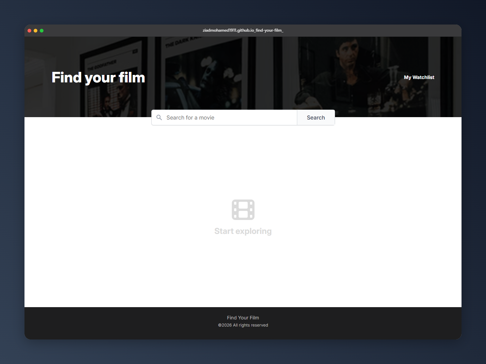

# Find Your Film

🔗 **[Live demo](https://ziadmohamed1911.github.io/find-your-film/)**

A movie search app built with HTML, CSS, and vanilla JavaScript. Search for any movie, see its rating, runtime, genre, and plot, and save your favorites to a personal watchlist that stays in your browser.

Movie data comes from the [OMDb API](https://www.omdbapi.com/).



## Features

- **Movie search**: type a title and press Enter or click Search
- **Detailed results**: each result shows the poster, title, IMDb rating, runtime, genre, and plot
- **Read more**: long plots are shortened and expand with one click
- **Add and remove from the watchlist**: the button toggles between "Watchlist" and "Remove", and the state is remembered after a refresh or a new search
- **My Watchlist page**: shows every saved movie, with a Remove button and an empty state when the list is empty
- **Error state**: a friendly message appears when a search finds nothing or something goes wrong
- **Poster fallback**: a placeholder image replaces posters that are missing or fail to load
- **Responsive layout**: cards and the search bar adapt to smaller screens

## Built With

- HTML5
- CSS3 (Flexbox, custom layout, hover and focus states)
- JavaScript (ES6+): `fetch`, `async/await`, `Promise.all`, event delegation, `localStorage`
- [OMDb API](https://www.omdbapi.com/)
- [Font Awesome](https://fontawesome.com/) icons
- [Inter](https://fonts.google.com/specimen/Inter) font from Google Fonts

## Project Structure

```
find your film/
├── index.html          # Search page
├── index.js            # Search, rendering, and watchlist toggle
├── style.css           # Shared styles
├── images/
│   └── header-bg.png   # Header background
└── pages/
    ├── watchlist.html  # My Watchlist page
    ├── watchlist.js    # Reads and renders saved movies
    └── watchlist.css   # Watchlist page styles
```

## Getting Started

1. Clone the repository:

   ```bash
   git clone https://github.com/ziadmohamed1911/find-your-film.git
   cd your-repo
   ```

2. Get a free API key from [omdbapi.com/apikey.aspx](https://www.omdbapi.com/apikey.aspx).

3. Open `index.js` and replace the key in both requests:

   ```javascript
   `https://www.omdbapi.com/?apikey=YOUR_API_KEY&s=${encodeURIComponent(query)}`
   `https://www.omdbapi.com/?apikey=YOUR_API_KEY&i=${film.imdbID}`
   ```

4. Run the project with a local server, for example the **Live Server** extension in VS Code, and open `index.html`.

> **Tip:** open both pages from the same address (for example `127.0.0.1:5500`). `localStorage` is separate for each origin, so the watchlist page only sees movies saved from the same address.

## How It Works

1. The search sends a request to OMDb with the `s=` parameter, which returns a list of matching movies with basic info.
2. For each result, a second request with the `i=` parameter (the movie's IMDb ID) fetches the details: rating, runtime, genre, and plot. These requests run in parallel with `Promise.all`.
3. The detailed results are rendered as cards. One click listener on the results container handles every "Read more" and watchlist button, including cards added later (event delegation).
4. The watchlist is saved as an array of movie objects in `localStorage` under the `watchlist` key. The search page and the watchlist page both read from it.

## What I Learned

- Calling an API with `fetch` and `async/await`, and handling empty and failed responses
- Combining multiple requests with `Promise.all`
- Rendering UI from data with template literals and `map`
- Event delegation for dynamically created elements
- Saving and reading data with `localStorage`
- Building layouts with Flexbox, including a sticky footer

## Future Improvements

- Pagination to load more than the first 10 results
- A loading indicator while results are fetched
- Sorting and filtering the watchlist
- Moving the shared card and watchlist code into a single shared script
- Hiding the API key behind a small backend before deploying publicly

## Notes

The OMDb free tier has a daily request limit. Each search makes up to 11 requests (one search plus one per result), so avoid searching on every keystroke.

## Author

**Ziad Mohamed**
